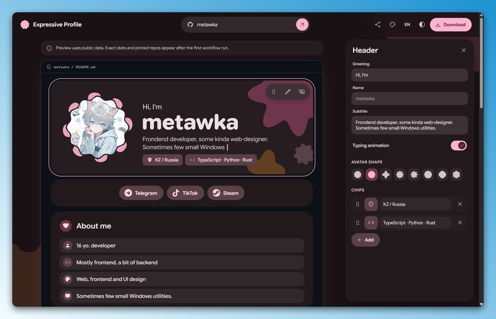
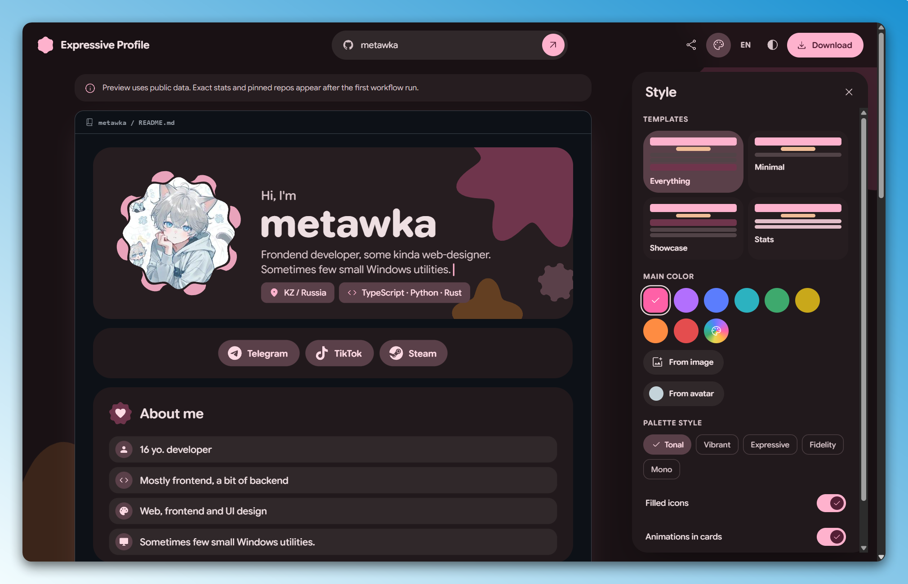
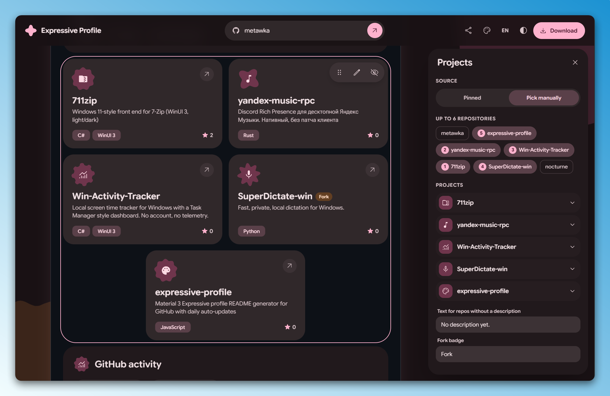
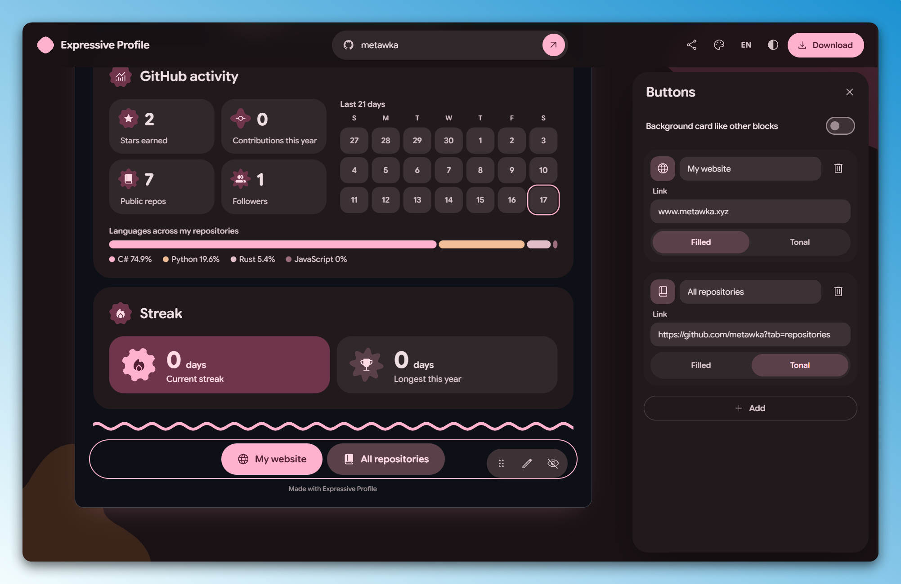
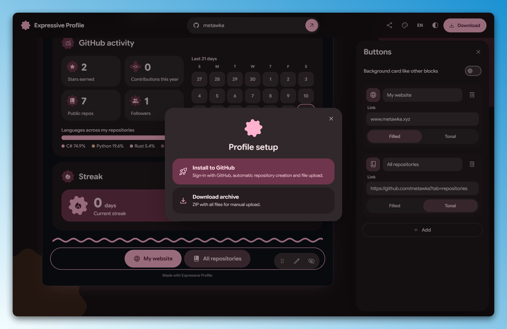
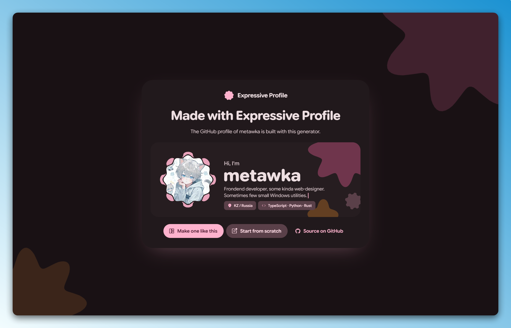

# Expressive Profile

Generator of GitHub profile READMEs in the Material 3 Expressive style. The profile is set up on the site and installed into the profile repository. A GitHub Action then refreshes the stats every day.

<p align="center">
  <a href="https://metawka.github.io/expressive-profile/"><b>Open the generator</b></a>
  &nbsp;·&nbsp;
  <a href="https://github.com/metawka">Live example</a>
  &nbsp;·&nbsp;
  <a href="https://github.com/marketplace/actions/expressive-profile">GitHub Marketplace</a>
</p>

<div align="center">

<a href="https://github.com/metawka"><picture><source media="(prefers-color-scheme: dark)" srcset="https://raw.githubusercontent.com/metawka/metawka/main/assets/hero-dark.svg"></picture></a>

<picture><source media="(prefers-color-scheme: dark)" srcset="https://raw.githubusercontent.com/metawka/metawka/main/assets/stats-dark.svg"></picture>

<picture><source media="(prefers-color-scheme: dark)" srcset="https://raw.githubusercontent.com/metawka/metawka/main/assets/streak-dark.svg"></picture>

<sub>Live cards from <a href="https://github.com/metawka">github.com/metawka</a>, refreshed daily by the Action. The look follows the GitHub light or dark theme.</sub>

</div>

## Features

- Blocks: header, socials, about, tech stack, project cards, activity, streak, divider, link buttons.
- Live preview with editing by click, drag to reorder, hiding blocks.
- Material 3 color palette built from one color, a custom color or an image. Five palette styles, light and dark themes.
- Eight Material 3 shapes for the avatar, project cards and social icons.
- Typing animation for the subtitle and animations in every card. Animations can be turned off.
- Icon search across Material Symbols and Simple Icons.
- Templates, a shareable link to a setup and a "make one like this" page for any profile built with the generator.
- English and Russian interface.

## Screenshots

<table>
  <tr>
    <td colspan="2"></td>
  </tr>
  <tr>
    <td colspan="2" align="center">Editor: live preview, editing by click, drag to reorder</td>
  </tr>
  <tr>
    <td width="50%"></td>
    <td width="50%"></td>
  </tr>
  <tr>
    <td align="center">Templates, main color and palette styles</td>
    <td align="center">Project cards from pinned or chosen repositories</td>
  </tr>
  <tr>
    <td width="50%"></td>
    <td width="50%"></td>
  </tr>
  <tr>
    <td align="center">Activity, streak and link buttons</td>
    <td align="center">Install to GitHub or download an archive</td>
  </tr>
  <tr>
    <td colspan="2"></td>
  </tr>
  <tr>
    <td colspan="2" align="center">The "Made with Expressive Profile" link under a profile opens a page with its setup</td>
  </tr>
</table>

## Usage

1. Open the [generator](https://metawka.github.io/expressive-profile/) and enter a GitHub username.
2. Set up the blocks and press **Download**.
3. **Install to GitHub** signs in with a GitHub code, creates the profile repository and uploads the files.

https://github.com/user-attachments/assets/ad14524b-1529-4637-8612-7cb41c5eee35

Manual setup: **Download archive** gives a ZIP for a public repository named exactly like the username. All files from it are uploaded to that repository, including the `.github` and `.profile` folders.

Signing in uses the GitHub device flow with the `public_repo` and `workflow` scopes. The token stays in the browser tab and is used only for this upload. The sign-in proxy is open source, see [`proxy/`](proxy). If the repository already has a README, the generator asks before replacing it.

The first workflow run replaces the preview data with exact stats and pinned repositories. Then the profile updates once a day and commits only when something changed.

To change the profile later, edit `profile.json` in the repository or set it up again on the site and upload the new `profile.json`.

## Made with Expressive Profile

- [metawka](https://github.com/metawka)

Profiles built with the generator can be added to this list with a pull request.

## Action

The archive contains this workflow:

```yaml
name: Expressive Profile

on:
  schedule:
    - cron: "17 3 * * *"
  workflow_dispatch:
  push:
    paths:
      - profile.json
      - .profile/icons.json

permissions:
  contents: write

jobs:
  update:
    runs-on: ubuntu-latest
    steps:
      - uses: actions/checkout@v4
      - uses: metawka/expressive-profile@v1
        with:
          token: ${{ secrets.PROFILE_TOKEN || github.token }}
```

| Input | Default | Description |
| --- | --- | --- |
| `token` | `github.token` | Token for the GitHub API |
| `commit-message` | `Updated profile` | Message of update commits |

With the default token the language chart counts public repositories only. Private repositories are counted with a personal access token saved as the `PROFILE_TOKEN` secret.

## Development

Requirements: Node.js 20 or newer.

```bash
npm install
npm run dev
```

`npm run build` builds the site into `dist` and the Action renderer into `action/render.mjs`.

The `proxy` folder contains the sign-in proxy deployed on Vercel. It forwards two device flow requests to GitHub and stores nothing.

## License

The code is under the [MIT License](LICENSE).

- Google Sans Flex and Roboto Flex: SIL Open Font License, see `fonts/`.
- Material Symbols: Apache License 2.0.
- Simple Icons: CC0 1.0. Brand icons belong to their owners.
